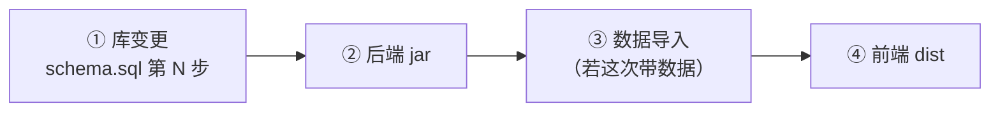

# 部署手册（唯一真源）

> 给**任何**接手这个项目的 AI 或人看。照着做就行，不需要问"上次那个会话是怎么弄的"。
>
> 最后更新：2026-10-23（变更-163，把当天的实际发布流程固化成脚本 + 手册）

---

## 0. 一分钟版

```powershell
# 后端（改了 Java / SQL / 配置）
cd D:\project\hnd_factory
.\scripts\deploy-api.ps1

# 前端（改了 Vue / CSS）
cd D:\project\hnd_factory_UI
.\scripts\deploy-web.ps1

# 只想看线上现在跑的什么（只读，不改任何东西）
cd D:\project\hnd_factory
.\scripts\verify-prod.ps1
```

**这两个脚本就是全部。** 下面所有内容都是"为什么要这么做"和"出事怎么办"。

---

## 1. 顺序铁律：库 → 后端 → 数据 → 前端



**为什么是这个顺序**（2026-10-23 实例，物料主数据重建）：

- 先发后端、后迁库 ⇒ 新代码查询 `name_norm` / `status` / `valuation_type` 等新列，
  旧表没有这些列，**页面直接 500**。
- 先发前端、后发后端 ⇒ 新页面调的 `/api/material/page`、`/api/material/facets`
  在老 jar 里不存在，**点了就是 404**。
- 数据导入要排在库和后端**之后**：导入走的是新后端的 `POST /api/material/import/preview`
  + `/commit` 两步接口，老后端没有这两个端点。

例外：纯前端改动（只动 Vue/CSS）当然只跑第 ④ 步。

---

## 2. 这台机器（以及两台电脑）的三个怪癖

### ① Node：现在正常了，但留一手

2026-10-21~22 期间本机 `node` 会崩（`0xC0000005`，任何 `vite`/`vitest` 都起不来），
当时的绕法是：

```powershell
$env:ELECTRON_RUN_AS_NODE = '1'
& 'C:\Users\Administrator\AppData\Local\Programs\DeepSeek Harness\DeepSeek Harness.exe' node_modules/vite/bin/vite.js build
```

**2026-10-23 复测：裸 `node` 已恢复**（node v24.20.0 / npm 11.19.0 / vite 6.4.3 /
vitest 566 用例全绿）。所以脚本里用的是普通的 `npm run build`。

> 如果哪天又出现 `0xC0000005`，别浪费时间排查 —— 直接用上面那段绕法，
> 把 `DeepSeek Harness.exe` 当成 `node` 用即可。

### ② 改文件用 python，不用 PowerShell here-string

PowerShell 的 here-string 遇到中文/引号/`<<'PY'` 容易炸（本机踩过两次：`@('a' 'b')` 少逗号、
heredoc 不支持）。批量改代码时写一个 `.py` 再执行：

```powershell
& 'C:\Program Files\python\python.exe' .\tmp\patch.py
```

**铁律：脚本里改文件必须"先读完再写"**。2026-10-22 有过一次
`open(p,'w')` 之后才 `read(p)`，把 `CostingDrilldownDialog.vue` 写成 0 字节，
构建报 `At least one <template> or <script> is required`。

### ③ 真的坏了的只有一件事：没有包管理器式的环境隔离

- 前端**只有 npm**（`package-lock.json` 是唯一锁文件，不许出现 `pnpm-lock.yaml`）。
- 装依赖用 `npm ci`，不要 `npm install`（会把锁文件往上漂，两台机器装出不同依赖树）。
- 后端 Gradle 用 `.\gradlew.bat`，**依赖 `shared-contract` 在同级目录**
  （`settings.gradle` 里是 `includeBuild('../shared-contract')`）。

---

## 3. 服务器坐标（写死在这里，脚本都从这里读）

| 项 | 值 |
|---|---|
| SSH | `eetig@124.220.60.154`，端口 `9002` |
| 私钥 | `%USERPROFILE%\.ssh\id_ed25519_hnd_deploy` |
| sudo 密码 | 放在 `%USERPROFILE%\.hnd-deploy.env`（**不进仓**）里：`HND_SUDO=***` |
| 后端容器 | `hnd_factory`，jar 在容器内 `/app/hnd_factory.jar` |
| 后端端口 | `127.0.0.1:8084` |
| 站点根 | `/opt/1panel/apps/openresty/openresty/www/sites/hnd-ui/index` |
| 站点端口 | `127.0.0.1:9091`（公网经 relay，`https://hbhnd.cloud`） |
| MySQL | 容器 `1Panel-mysql-Ipel`，库 `factory_db` |
| OCR | 容器 `myocr`，宿主 `127.0.0.1:8085`（后端经 `/api/ocr-proxy/*` 转发） |

> ⚠️ 公网 443 **不在本机**，前面还有一道 relay。所以**不要**假设"线上 nginx 就是这台机器的
> openresty"—— 排查 502 时先分清是哪一跳。
> ⚠️ `/api/ocr` 这个前缀在公网被劫持成 502（relay 上游是死的），应用统一走 `/api/ocr-proxy/`。

---

## 4. 前端发布（三步，缺一不可）

`scripts/deploy-web.ps1` 做的就是这三步，**手动做时也别跳**：

```bash
# ① 备份现站 + 建干净的暂存目录（注意：这一步会 rm -rf 暂存目录）
R=/opt/1panel/apps/openresty/openresty/www/sites/hnd-ui
cp -a $R/index $R/index.bak-$(date +%Y%m%d-%H%M%S)
rm -rf /tmp/hnd-ui-new && mkdir -p /tmp/hnd-ui-new/assets

# ② 上传 dist 到 /tmp/hnd-ui-new（scp -r dist/* ）

# ③ 整目录原子切换（不要逐个文件覆盖！会出现在线用户白屏窗口）
S=$R
sudo cp -a /tmp/hnd-ui-new $S/index.new
sudo chown -R root:root $S/index.new
sudo mv $S/index $S/index.prev.$(date +%Y%m%d-%H%M%S)
sudo mv $S/index.new $S/index
```

**坑（真实踩过）**：① 里那句 `rm -rf /tmp/hnd-ui-new` 会**删掉刚上传的文件** ——
如果先上传再跑备份，上传白做、线上还是旧版本，而且 `curl` 一看"切换成功"其实什么都没换。
所以顺序必须是 **备份 → 建空目录 → 上传 → 切换**。

验收（脚本会自动做）：

```bash
curl -s http://127.0.0.1:9091/ | grep -o 'assets/index-[^"]*'   # 必须与 dist 里的文件名一致
md5sum $S/index/assets/index-*.js   # 必须与 /tmp/hnd-ui-new 里的一致
```

---

## 5. 后端发布

```powershell
cd D:\project\hnd_factory
.\gradlew.bat test          # 先测：bootJar 不会触发测试
.\gradlew.bat bootJar       # 产物 build\libs\hnd_factory.jar（82 MB 左右）
```

然后**上传 → 进容器 → 重启 → 核对 md5**：

```bash
# 本地算 md5，上传到 /tmp/hnd_factory-new.jar
scp -P 9002 -i <key> build/libs/hnd_factory.jar eetig@host:/tmp/hnd_factory-new.jar

# 服务端
echo "$HND_SUDO" | sudo -S -p '' cp /tmp/hnd_factory-new.jar /opt/hnd_factory/hnd_factory.jar
docker cp /opt/hnd_factory/hnd_factory.jar hnd_factory:/app/hnd_factory.jar
docker exec hnd_factory md5sum /app/hnd_factory.jar     # ★ 必须与本地 md5 一致
docker restart hnd_factory
sleep 34                                                 # 起 Spring Boot 约 20~30s
curl -s -o /dev/null -w '%{http_code}' http://127.0.0.1:8084/api/material/page   # 期望 200
```

**为什么不用 1Panel 重新构建镜像**：`DEPLOY.md` / `DEPLOY-hnd_factory.md` 写的是最初
"构建镜像 + 建容器"那套；日常发版用 `docker cp` + `restart` 就够了（30 秒 vs 5 分钟），
镜像只在改 `Dockerfile` / JVM 参数时才需要重建。**两份旧文档保留作历史，日常发版看本手册。**

---

## 6. 数据库变更

### 规矩

- 所有库变更都写进 `docs/schema.sql` 的**编号步骤**（当前到第 25 步），
  每步都要有：**为什么 / 改前核对 / 改后核对 / 回滚方式**。
- 种子数据单独放文件（例：`docs/material-dict-seed.sql`），**幂等**
  （`ON DUPLICATE KEY UPDATE`），可以重复执行。
- 破坏性操作（重建表）**必须先把旧表改名备份**，不要 `DROP`：

```sql
RENAME TABLE material_master TO material_master_bak_1023;
```

### 执行

```powershell
cd D:\project\hnd_factory
# 只跑 schema.sql 里指定的那一步（按 "-- 第 25 步" 标记切出来）
.\scripts\db-apply.ps1 -Step 25

# 或跑一个独立的种子/补丁文件
.\scripts\db-apply.ps1 -File .\docs\material-dict-seed.sql
```

脚本做的事：切出那一步 → scp 到 `/tmp/` → `docker exec mysql < /tmp/x.sql` → 打印该步骤涉及的表的行数。

**注意**：`docs/schema.sql` 前半部分是建库脚本（`CREATE TABLE IF NOT EXISTS`），
**不要整份重跑** —— 里面有些步骤是"重建表"，重跑会覆盖数据。只跑你要的那一步。

### 实例：2026-10-23 物料主数据重建（第 25 步）

```sql
RENAME TABLE material_master TO material_master_bak_1023;   -- 246 行，留作回滚
-- 执行 docs/schema.sql 第 25 步：建 material_master + 4 张字典表
-- 执行 docs/material-dict-seed.sql：灌 10 条物料类型
```

然后**数据**从新接口导入（30,434 行 Excel）：

```bash
TOKEN=$(curl -s -X POST $B/api/login -H 'Content-Type: application/json' \
  -d '{"username":"admin","password":"admin123"}' | sed -n 's/.*"token":"\([^"]*\)".*/\1/p')

# ① 预览（返回一个 token + 差异统计）
curl -s -X POST $B/api/material/import/preview -H "satoken: $TOKEN" -F "file=@/tmp/material.xlsx"

# ② 确认写入
curl -s -X POST "$B/api/material/import/commit?token=$IMPTOKEN" -H "satoken: $TOKEN"
```

导入后**逐项核对**（数字在 schema.sql 第 25 步的注释里）：

| 指标 | 期望 |
|---|---|
| 总行数 | 30,434 |
| 物料编码数 | 30,392 |
| status 1 / 2 / 0 | 22,908 / 2,136 / 5,390 |
| 有评估类型 | 42 |
| 价格 > 0 | 7,938 |

---

## 7. 验收清单（每次发版都过一遍）

`scripts/verify-prod.ps1` 会把这些打出来：

1. **前端**：线上 `index.html` 引用的 `assets/index-*.js|css` 与本地 `dist` 一致；
   文件名 200 且体积合理。
2. **后端**：容器内 jar `md5sum` 与本地 `build/libs/*.jar` 一致；
   `docker inspect ... StartedAt` 是刚才。
3. **接口**（期望码）：`/api/material/page` 200、`/api/material/facets` 200、
   `/api/purchase/list` 200、`/api/ocr-proxy/recognize` 415（无文件时的正确码）。
4. **页面**：`/materials/master`、`/materials/import`、`/purchase/entry`、
   `/purchase/board`、`/equipment/board`、`/maintain/image-parse` 都不出现 404、
   不弹红色 toast。
5. **库**：这次动的表行数符合预期（见上表或该步骤注释）。

> 用户侧的最后一公里：**Ctrl+F5** 清缓存。不发版也要提一句，否则他看到的是旧 JS。

---

## 8. 回滚

| 层 | 怎么退 |
|---|---|
| 前端 | 站点根下留了 `index.prev.<时间戳>`：`sudo rm -rf index && sudo mv index.prev.<ts> index` |
| 后端 | 重发上一版 jar（本地 `build/libs` 或服务器上的旧副本），`docker cp` + `restart` |
| 库（第 25 步） | `RENAME TABLE material_master TO material_master_v159, material_master_bak_1023 TO material_master;` |

**保留期**：确认线上稳定 **≥ 3 天**再清 `index.prev.*` 与 `*_bak_*` 表。
清理前先 `du -sh` 看一下体积，别把磁盘（80G，常年 50% 左右）塞满。

---

## 9. 坑位清单（都是真踩过的，按时间倒序）

| # | 现象 | 根因 / 对策 |
|---|---|---|
| 1 | 前端"切换成功"但线上还是旧 JS | 备份脚本里的 `rm -rf 暂存目录` 把刚上传的文件删了；顺序必须 备份→建空→上传→切换 |
| 2 | 列勾多了「物料名称」列消失 | 表格 `max-w-[1100px]` + 唯一自适应列 ⇒ 剩余空间为负被压成 0 宽；改成每列固定宽 + `min-width` 求和 + 横向滚动 |
| 3 | 抽屉被页面头卡压住（标题少半行） | 层叠上下文：抽屉遮罩渲染在 `.page-mount` 里；给 `el-drawer` 加 `append-to-body` |
| 4 | 抽屉动画"太快/动作太大" | 弹簧曲线有 1.163 过冲；且 `append-to-body` 后 EP 的位移 transition 首帧被合并（实测 `getAnimations()` 为空）⇒ 内容层自己做 keyframes |
| 5 | 保存后重开还是旧内容 | `openCreate` 只清 `row`，抽屉 draft 在 `modelValue` 变 true 时重建；要清字段得调组件暴露的方法 |
| 6 | jsdom 里给 `globalThis.localStorage` 赋值报错 | 只有 getter；测试用 `vi.stubGlobal('localStorage', fake)` |
| 7 | 组件测试 20 条全红（teleport） | 抽屉 `append-to-body` 后 DOM 不在 wrapper 里；把 `appendToBody` 做成 prop，测试传 `false`（`teleport` 打桩会让 ElSelect 递归更新） |
| 8 | OCR 502，页面弹出整段 HTML | 公网 `/api/ocr` 前缀被 relay 的坏上游劫持；改后端 `/api/ocr-proxy/*` 转发；错误提示只对 JSON 取 `msg`，其余给人话 |
| 9 | 注册接口 401（生产） | 容器跑的是旧 jar（`docker cp` 没做）；务必核对容器内 md5 |
| 10 | App 滑动验证"对准了也不通过" | 百分比以 thumb 左边为基准 vs 刻度按轨道宽 ⇒ 系统误差；改成 thumb 中心基准 |
| 11 | 表格行 `cursor-pointer` 但键盘不可用 | 可点的行/单元格必须 `tabindex="0"` + `@keydown.enter/space`（护栏里有断言） |
| 12 | 提交信息与内容对不上 | 别的会话用了 `git add -A`，把未提交的无关改动扫进去；**只 stage 自己改的路径** |

---

## 10. 门禁（不绿不许部署）

| 仓 | 命令 | 当前基线 |
|---|---|---|
| 前端 | `npm run verify`（lint + build + vitest） | 40 文件 / 566 用例 |
| 后端 | `.\gradlew.bat test` | 见 `build/reports/tests` |

改完代码还要按项目约定记账：

- 前端仓 `前后端改动统筹.md` 追加一行 `变更-NNN`（为什么 + 怎么验证）；
- 后端仓 `docs/待办清单.md` 勾掉做完的项；
- 库变更 → `docs/schema.sql` 编号步骤。

---

## 11. 附：为什么要写成脚本

2026-10-23 之前，这些命令只存在于**某个会话的上下文里**。新开一个会话，它不知道
暂存目录、不知道 sudo 密码从哪来、不知道先库还是先后端 —— 于是"部署不出来"。

脚本化之后，能力落在仓库里，不落在会话里。**改流程就改脚本 + 改这份手册**，
下一个会话自然就"和你一样丝滑"。
